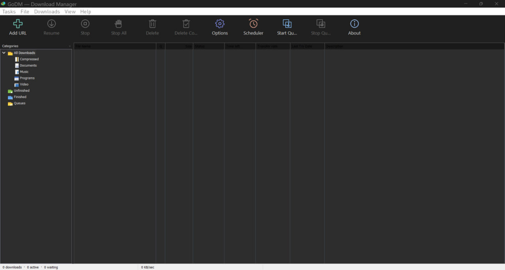

<p align="center">
  <a href="https://github.com/wizvenex7-a11y/Craft-IDM">
    
  </a>
</p>

<h1 align="center">GoDM</h1>

<p align="center">
  <strong>A powerful, open-source download manager written in Go.</strong>
  <br>
  Manage downloads, use multiple connections, resume interrupted transfers and capture browser downloads.
  <br>
  <sub>Craft-IDM repository · Desktop application and cross-platform command-line engine</sub>
</p>

<p align="center">
  
  
  
  
  
</p>

<p align="center">
  <a href="https://github.com/wizvenex7-a11y/Craft-IDM/releases">
    
  </a>
  <a href="https://github.com/wizvenex7-a11y/Craft-IDM">
    
  </a>
</p>

<p align="center">
  <a href="#features">Features</a> ·
  <a href="#screenshots">Screenshots</a> ·
  <a href="#desktop-app">Desktop app</a> ·
  <a href="#command-line">CLI</a> ·
  <a href="#browser-integration">Browser integration</a> ·
  <a href="#build-from-source">Build</a> ·
  <a href="#license">License</a>
</p>

---

## Overview

**GoDM** is an original, open-source download manager inspired by the feature set of Internet Download Manager (IDM). It is written in Go and provides a Windows desktop application, a command-line client and a browser integration helper.

GoDM is an independent implementation. It does not contain, copy or decompile IDM code.

The project has two main programs:

- **GoDM.exe** — the Windows desktop application, with a download list, categories, progress windows, tray support, clipboard monitoring, scheduler and configurable options.
- **godm-cli** — the command-line download manager and browser native-messaging helper. The CLI runs on Windows, macOS and Linux.

The download engine uses the Go standard library. The Windows desktop interface uses the [Walk toolkit](https://github.com/lxn/walk).

## Features

<table>
  <tr>
    <td width="50%" valign="top">
      <h3>⚡ Multi-connection downloads</h3>
      Up to 32 parallel HTTP range connections per file (8 by default), with dynamic segmentation to keep available connections working.
    </td>
    <td width="50%" valign="top">
      <h3>↻ Pause and resume</h3>
      Resume downloads after closing the app, a crash or a network interruption. Saved segment state and HTTP validators help avoid mixing versions of a file.
    </td>
  </tr>
  <tr>
    <td width="50%" valign="top">
      <h3>🌐 Browser integration</h3>
      Capture downloads from Chrome, Edge, Brave and Firefox. Send links with browser cookies and referer information to GoDM.
    </td>
    <td width="50%" valign="top">
      <h3>⏱ Queue and scheduler</h3>
      Control simultaneous downloads, schedule start and stop times, and choose an action when a scheduled queue finishes.
    </td>
  </tr>
  <tr>
    <td width="50%" valign="top">
      <h3>🎨 Themes and languages</h3>
      Switch between Dark, Light and Same as Windows themes. The interface includes English, French, Arabic, Spanish and German.
    </td>
    <td width="50%" valign="top">
      <h3>📊 Live web dashboard</h3>
      Monitor speed, progress and ETA in a local dashboard. Add, pause, resume and remove downloads from your browser.
    </td>
  </tr>
</table>

Additional capabilities include:

- Automatic retry for temporary connection failures.
- Global and per-download speed limits.
- Download categories for compressed files, documents, music, videos, programs and general files.
- File names based on server `Content-Disposition`, URL and content type.
- Optional SHA-256, SHA-1 and MD5 checksum verification.
- HTTP Basic site logins and custom request headers.
- Clipboard link detection in the desktop application.
- System-tray operation, start with Windows and single-instance behavior.
- Download-later support and queue controls.

## Screenshots

<p align="center">
  
  <br>
  <sub>GoDM — desktop application preview.</sub>
</p>

The application icon displayed at the top of this README is taken directly from `internal/gui/assets/app.png`.

## Desktop app

The Windows desktop application includes a toolbar, category tree, download list and individual progress windows.

| Area | Capabilities |
|---|---|
| Toolbar | Add URL, Resume, Stop, Stop All, Delete, Delete Completed, Options, Scheduler, Start Queue, Stop Queue and About |
| Categories | All Downloads, Compressed, Documents, Music, Programs, Video, Unfinished, Finished and Queues |
| Download list | File name, size, status, time left, transfer rate, last try and description; sortable columns and context actions |
| Progress window | Download address, downloaded size, speed, ETA, resume support and per-connection progress |
| Add URL | Paste a URL, optionally provide login details, inspect file information and choose the category, folder and filename |
| Download complete | Open the file, choose an application or open its containing folder |
| System tray | Keep downloads running after closing the main window; use the tray menu to exit |
| Clipboard monitoring | Detect copied file links and offer to download them |
| Scheduler | Schedule queue start and stop times, once or daily, and choose what happens after completion |
| Options | Configure connections, concurrent downloads, speed limits, retries, folders, categories, clipboard, dialogs and startup |

**Keyboard shortcuts:** `Ctrl+N` adds a URL, `Delete` removes selected downloads, `Ctrl+A` selects all and `Enter` opens the selected item.

Closing the desktop window keeps GoDM running in the system tray. Start it hidden with:

```bat
GoDM.exe -tray
```

### Theme, language and file types

- **Theme:** choose Dark, Light or Same as Windows from `View → Theme` or `Options → Appearance`. Theme changes are applied live and saved in `config.json`.
- **Languages:** English, Français, العربية, Español and Deutsch are included. Change the language from `View → Language` or `Options → Appearance`.
- **Custom languages:** use `View → Language → More languages...` to open the language folder and create a translation from `_template.json`. Set `rtl: true` for right-to-left languages.
- **File type:** change the extension in the Download File Info dialog. The Save As name and category folder follow the selected type.

## Command line

The `godm-cli` program uses the same download engine and saved state as the desktop application. Run only one manager mode at a time when using the shared data.

### Build and download a file

```bash
godm-cli get https://example.com/big.iso -c 16
godm-cli get https://example.com/file.zip -o renamed.zip -d ~/Downloads -limit 500
```

Press `Ctrl+C` to stop. Running the same command again resumes the download when the server supports it.

### Run the manager and dashboard

```bash
godm-cli serve
godm-cli ui
godm-cli add URL1 URL2
godm-cli add https://example.com/file.zip -at "23:30"
godm-cli add https://example.com/file.zip -paused -c 4 -referer https://site/
godm-cli list
godm-cli pause all
godm-cli resume all
godm-cli rm <id>
godm-cli limit 1024
```

The `serve` command starts the local manager and prints the dashboard address and access token.

### Web dashboard and local API

Open the address printed by `godm-cli serve` (the default dashboard address is `http://127.0.0.1:9614`).

The dashboard provides live per-connection progress, transfer speed and ETA. It can also add, pause, resume and remove downloads and update settings.

The local HTTP API is bound to `127.0.0.1`. API requests require the generated token through `X-GoDM-Token` or a Bearer authorization header. Passwords and cookies are not returned by the API.

| Method | Endpoint | Purpose |
|---|---|---|
| GET | `/api/downloads` | List downloads |
| POST | `/api/downloads` | Add one or more downloads |
| GET | `/api/downloads/{id}` | Get a download |
| POST | `/api/downloads/{id}/pause` | Pause a download |
| POST | `/api/downloads/{id}/resume` | Resume a download |
| DELETE | `/api/downloads/{id}` | Remove a download |
| POST | `/api/pause-all` / `/api/resume-all` | Pause or resume all downloads |
| GET / PUT | `/api/settings` | Read or update settings |

### Configuration location

GoDM stores settings and saved logins in `config.json`:

| System | Default location |
|---|---|
| Windows | `%AppData%\godm` |
| macOS | `~/Library/Application Support/godm` |
| Linux | `~/.config/godm` |

Set `GODM_HOME` to use a different data directory.

## Browser integration

GoDM includes an extension for Chrome, Edge, Brave and Firefox, together with a native-messaging helper.

**With the desktop application:**

1. Open **Options → Browser → Set up browser integration**.
2. Open `chrome://extensions` or `edge://extensions`.
3. Enable **Developer mode** and choose **Load unpacked**.
4. Select the `extension` folder from the GoDM installation directory.
5. Restart the browser.

**With the CLI only:**

1. Start the manager with `godm-cli serve`.
2. Load the repository's `extension/` folder as an unpacked extension.
3. Register the native host:

```bash
godm-cli install-host -chrome-id <extension-id>
godm-cli install-host -firefox
```

4. Restart the browser.

Click the extension icon to enable or disable capturing. If GoDM is not running, the browser keeps the download instead of losing it.

## Build from source

### Requirements

- [Go 1.22 or newer](https://go.dev/dl/)
- Git
- [NSIS](https://nsis.sourceforge.io/) only when building the Windows installer

### Clone the repository

```bash
git clone https://github.com/wizvenex7-a11y/Craft-IDM.git
cd Craft-IDM
```

### Build commands

Run these from the repository root:

```bash
make build       # Build godm-cli for the current operating system
make windows     # Build the Windows desktop app and CLI (amd64)
make installer   # Build the Windows app and create the NSIS installer
make test        # Run tests with the race detector
make release     # Build release binaries for supported targets
```

The Windows build outputs are placed in `installer/`. The installer target creates `installer/GoDM-Setup-2.0.0.exe` and requires NSIS.

### Build on Windows without Make

From Command Prompt or PowerShell:

```bat
go build -ldflags "-H windowsgui" -o GoDM.exe .\cmd\godm-gui
go build -o godm-cli.exe .\cmd\godm
```

To create the installer, install NSIS and run:

```bat
makensis installer\godm.nsi
```

### Windows application icon resources

The GUI uses `cmd/godm-gui/rsrc_windows_amd64.syso` for its Windows icon and manifest. Rebuild the resource after changing the icon:

```bash
make resources
make windows
```

The optional `make idm-icon` target runs the PowerShell icon-extraction helper against a locally installed Internet Download Manager executable. It writes `internal/gui/assets/app.png` and `installer/godm.ico`; use `IDM_EXE` when IDM is installed in a non-standard location.

## Project structure

```text
Craft-IDM/
├── cmd/
│   ├── godm-gui/       Windows desktop application
│   └── godm/           Command-line application
├── extension/          Chrome, Edge and Firefox extension
├── internal/
│   ├── config/         Settings and saved logins
│   ├── engine/         HTTP downloads, segments, retries and checksums
│   ├── gui/            Windows interface, dialogs, tray and translations
│   ├── manager/        Queue, scheduler, concurrency and saved state
│   ├── nativehost/     Browser native-messaging helper
│   └── server/         Local API and embedded web dashboard
├── scripts/            Build and icon utilities
├── Makefile
├── go.mod
└── README.md
```

## Current limitations

The following are not included yet:

- FTP downloads.
- HLS/DASH video stream downloading.
- Website grabber or spider.
- Multiple separately named queues.
- A native macOS or Linux desktop window. On those systems, use `godm-cli` and the web dashboard.

## Contributing

Issues, bug reports and pull requests are welcome.

1. Fork the repository.
2. Create a branch for your change.
3. Run the tests with `make test`.
4. Submit a pull request with a clear description.

## License

GoDM is released under the [MIT License](LICENSE).

---

<p align="center">
  <a href="https://github.com/wizvenex7-a11y/Craft-IDM">
    
  </a>
  <br>
  <strong>GoDM</strong>
  <br>
  Built with Go.
  <br><br>
  <a href="https://github.com/wizvenex7-a11y/Craft-IDM">GitHub Repository</a> ·
  <a href="https://github.com/wizvenex7-a11y/Craft-IDM/issues">Report an issue</a> ·
  <a href="https://github.com/wizvenex7-a11y/Craft-IDM/releases">Releases</a>
</p>
